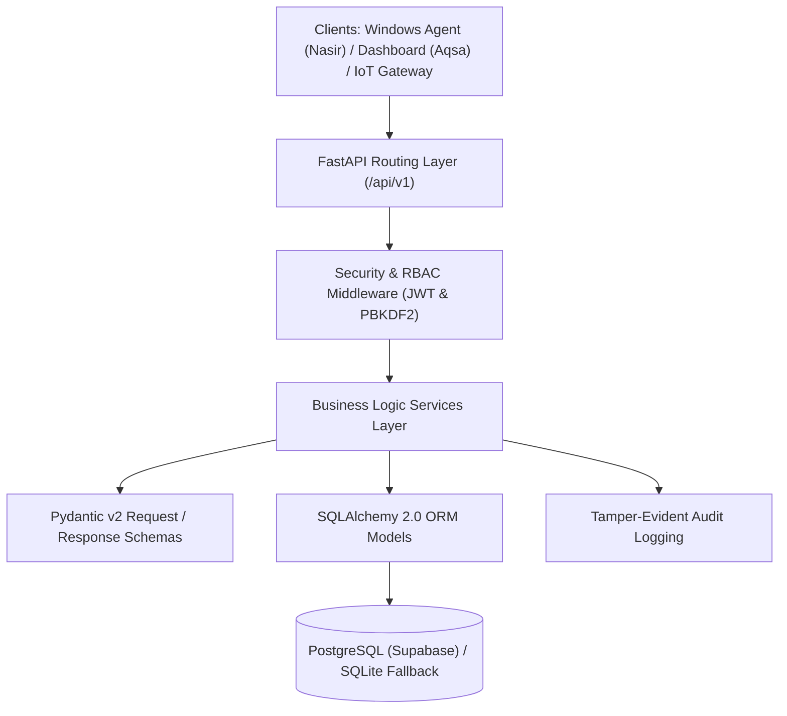

# Month 1 — Requirements & Architecture Baseline

**Project:** LabGuard-X: Autonomous Infrastructure Management & Security System  
**Lead / Backend Owner:** Muhammad Suleman  
**Deliverable Milestone:** M1 (Requirements, Architecture, Data Model & Scope Baseline)  

---

## 1. Executive Summary & Scope

LabGuard-X is an autonomous infrastructure monitoring and safety automation platform designed for university computing and research laboratories.
- **Prototype Scope:** 3–5 Windows testbed PCs/laptops + IoT environmental sensor nodes.
- **Backend Architecture:** Asynchronous FastAPI service layered cleanly across Core, API routers, SQLAlchemy models, Pydantic schemas, and Service logic.
- **Resilient Database Layer:** Dual-mode architecture configured for Supabase PostgreSQL with automated offline SQLite fallback.

---

## 2. Backend Layered Architecture (S-01)

The system enforces strict separation of concerns across 5 modular layers:



### Folder Structure
```text
backend/
├── app/
│   ├── main.py                  # Application entry point, CORS, exception handlers
│   ├── core/                    # Config (Pydantic Settings), DB engine, Security, Errors
│   ├── api/v1/                  # RESTful API endpoints (auth, devices, telemetry, events, alerts, policies, commands, audit, iot, ai)
│   ├── models/                  # 12 SQLAlchemy ORM database models
│   ├── schemas/                 # Pydantic v2 request/response validation schemas
│   └── services/                # Encapsulated business logic layer
├── migrations/                  # Alembic database versioning scripts
├── tests/                       # Automated test suite (pytest)
├── .env.example                 # Environment variable template
└── requirements.txt             # Project dependencies
```

---

## 3. Initial Data Model (S-02 — 12 Core Entities)

1. **`users`**: Administrative, operator, teacher, and student accounts.
2. **`labs`**: Physical lab rooms, buildings, capacity, and active states.
3. **`devices`**: Monitored PC agents and hardware sensor nodes.
4. **`device_configs`**: Configurable sampling rates, reporting intervals, and sensitivity settings.
5. **`telemetry`**: Time-series PC hardware metrics (CPU%, RAM%, Disk%) and environmental sensor data.
6. **`heartbeats`**: High-frequency liveliness check-ins and agent version tracking.
7. **`events`**: Security, compliance, and environmental incident logs.
8. **`alerts`**: Prioritized incident notifications requiring triage and operator acknowledgment.
9. **`policies`**: Deterministic automation rules and Exam Mode compliance policies.
10. **`device_commands`**: Remote actuation commands (reboot, lock, unlock, buzzer).
11. **`audit_logs`**: Immutable audit logs of all privileged administrative actions.
12. **`ai_inferences`**: Machine learning anomaly scores and hazard classifications.

---

## 4. Team Dependencies & Handoff Sheet

| Team Member | Domain | Backend Deliverable to Member | Member Deliverable to Backend |
|---|---|---|---|
| **Nasir** | Windows Agent / Client | Device registration API, Heartbeat endpoint, Policy format, Remote command format | Agent hardware identity, PC health metrics, USB security events, policy ack |
| **Aqsa** | Web Dashboard / Frontend | REST API endpoints, JWT Bearer auth, Standardized JSON response envelope, Pagination | Dashboard user actions, triage inputs, alert acknowledgment |
| **Hamza** | AI / Anomaly Detection | Telemetry time-series format, data export schema, inference ingest endpoint | ML anomaly score, confidence level, risk classification, explanation JSON |
